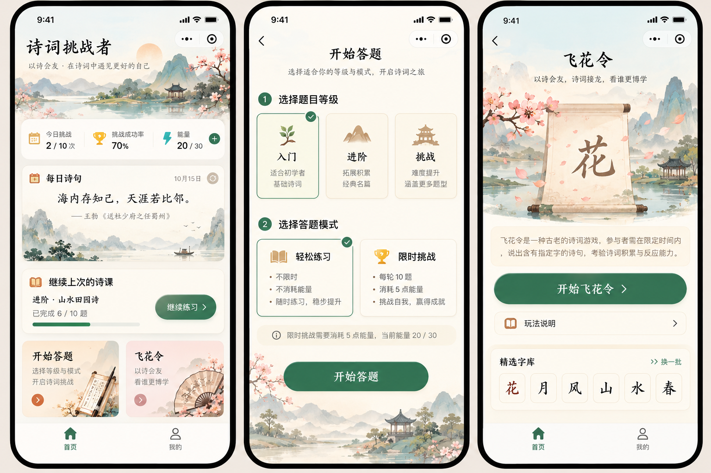
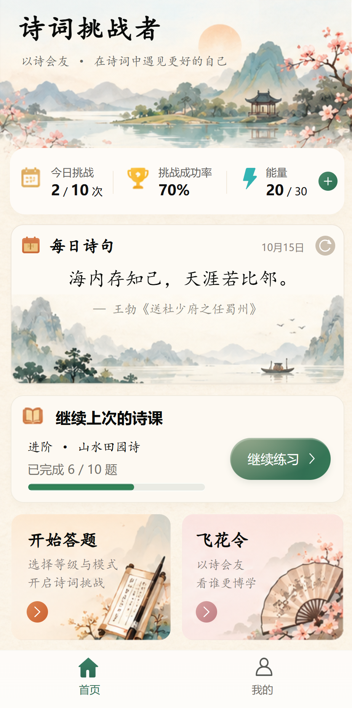
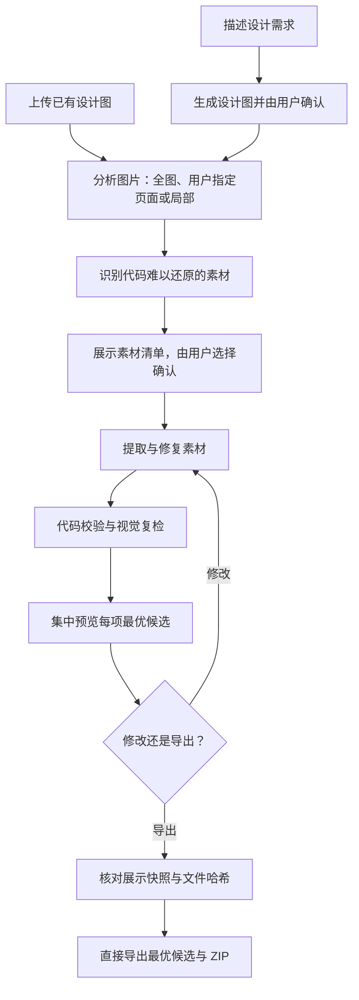

# ui-assets-skill

从 UI 设计图中提取代码难以还原的复杂背景、插画和图标，供 Agent 开发使用；支持先生成设计图再提取，也支持上传图片直接提取。

## 项目背景

用 ChatGPT 生成设计稿后，再交给 Agent 开发，常会遇到这样的落差：页面结构和功能都已实现，成品却少了设计稿中的质感。复杂背景的层次、插画的笔触或图标的造型，一旦被简化或重新绘制，就可能改变整个页面的视觉效果。

反复要求“严格还原”很难解决所有细节。对于代码难以准确表达的画面，更合适的做法是先提取为独立素材，让 Agent 在开发时直接使用。布局、文字、按钮、圆角、边框和普通阴影等容易用代码实现的部分，则交给代码处理，无需切成图片。

**ui-assets-skill** 围绕这一分工，将看图分析、素材选择、裁切修复、代码校验、视觉复检和用户验收串成一套流程。提取时处理文字与控件遮挡、图标边界和背景残留，尽量保留原稿的构图与主要视觉内容，为后续开发提供可用素材。

## 效果展示

以下示例从设计图中提取复杂背景、插画和图标，再将素材用于 HTML 页面；布局、文字和常规控件由代码实现。

### 原始设计图



### 首页还原效果

对应上方设计图左侧的首页。下图为 [HTML 演示页面](docs/display/index.html) 的实际运行截图。



下载仓库后，用浏览器打开 `docs/display/index.html` 可查看交互效果；GitHub 文件页展示 HTML 源码，README 中通过截图预览。

## 流程

1. **获取设计图**：可以直接上传图片或者使用 ChatGPT 直接生成设计图。
1. **先确定范围**：当没有明确说明提取图片中的内容范围时，先询问切整图、指定页面、区域还是某类素材；明确表示“不补充范围”后，才按全图处理。
2. **再分析素材**：只分析确认范围内的内容，判断拆分方式和输出格式。
3. **列出编号清单**：用户选择导出项，也可提出拆分、合并等修改。
4. **确认后处理**：清单修改完成并确认后，才开始提取、修复或生成。
   SVG 与复用资源先准备输入文件；缺文件时等待但不消耗次数，补齐后再次处理会自动续接，不需要重开一轮，批次其他已就绪素材仍继续处理。
5. **集中验收**：全部完成后统一展示，支持一次通过或按编号修改。



## 使用环境

当前支持范围为 **ChatGPT 桌面端中可加载本地 skill 的工作环境**，需要具备图片查看、文件读写和 Python 执行能力。生成设计、去字或补绘还需要会话提供图像生成/编辑工具。

其他 Agent 兼容版本后续会验证补充。

本地脚本依赖：Python 3.10+、Pillow、NumPy。SVG 验证还需要宿主提供实际 SVG 渲染能力；缺少渲染证据时不能按已完成处理。

## 安装

把下面内容发送 ChatGPT 即可，由它安装 skill 并准备运行依赖：

```text
帮我安装 skill：https://github.com/你的用户名/ui-assets-skill

请实际执行以下步骤：
1. 下载并检查仓库，将 skill 安装到当前客户端支持的用户技能目录，名称为 ui-assets-skill。确认 SKILL.md、scripts/、references/ 和 requirements.txt 完整；已有安装时保留用户配置和任务数据。
2. 检查可用的 Python 3.10+，已有则复用；没有则根据当前系统，通过官方来源或可信系统包管理器安装，优先使用用户级安装。
3. 在 skill 目录创建或复用 .venv，使用其中的 Python 按 requirements.txt 安装依赖，包括 Pillow、NumPy，不修改全局 Python 包。
4. 验证依赖可正常导入，并使用该环境运行 scripts/studio.py --help。后续执行 skill 脚本也使用这个 Python。
5. 检查当前会话是否有图片查看、生图和编辑工具；不生成测试图片，不自动配置或调用付费 API。工具缺失时说明受影响的功能。
6. 完成后报告 skill 安装路径、Python 路径与版本、验证结果和调用方式。

需要系统授权时按环境的授权流程处理，其余步骤继续执行。遇到权限、网络、私有仓库访问或客户端能力限制时，说明具体阻碍及需要我完成的最小操作；未验证成功时不要宣称安装完成，也不要要求我在聊天中发送密钥。
```
## 使用方法

### 先生成设计，再切图

```text
使用 ui-assets-skill，生成一个国风诗词学习 App 首页。
先让我确认设计，再分析背景、插画和图标，展示切图清单供我选择。
```

流程：描述需求 → 生成设计 → 确认设计 → 分析范围与素材 → 确认清单 → 处理与复检 → 展示最终候选 → 修改或导出。

### 上传设计图直接切图

上传图片后输入：

```text
使用 ui-assets-skill 分析这张设计图，只处理首页。
列出可提取的背景、插画和图标，展示清单后由我选择。
```

## 生图不可用时怎么办

默认使用 ChatGPT 会话提供的原生生图/编辑工具，**无需配置生图 API Key**。

工具不可用或调用失败时，skill 要求在当前回复中提示受影响任务和实际已知原因；原因未知时明确说明未知。相关素材保留为待办，不会作为已完成结果交付。脚本也会返回待处理或处理失败提示，但无法自行探测 ChatGPT 工具的额度、权限和运行状态，需要执行 agent 根据实际工具返回说明。

可以选择稍后重试、上传已有设计图或修复候选，或者主动选择配置 API。已有图不需要重建的部分仍可继续裁切和检查。

## 检查与交付边界

素材提取分析最多执行 3 次检查，发现问题后先修改再复检；仍未满足时展示问题，由用户修改或明确允许后续处理。素材生成与修复每阶段最多处理 2 次；SVG 图标两版均完成有效原图对比仍不合格时，可自动转源图透明 PNG，额外最多处理 2 次，无需再次确认格式。两阶段分开计数并保留全部记录，之后集中展示最优候选供用户决定。

尺寸、透明度、保护区和文件一致性由脚本校验；整体构图、主要对象、残字和接缝仍依赖视觉复核。检查能减少错误，但不能保证未知遮挡区域与原始设计完全一致，也不能保证 agent 永不误判。

交付包含独立素材、预览、清单、质量报告、参考原图和 ZIP。

## 交流与反馈

这个 skill 还在初期打磨中，欢迎大家提出使用中遇到的问题和修改意见。可以扫描下方二维码联系我，一起完善它。


